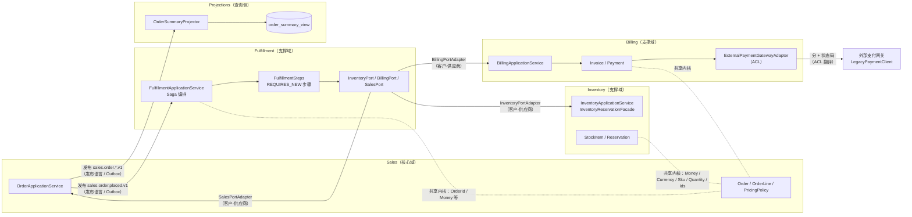

# 03 · 上下文映射（Context Map）

## 概念

上下文映射描述**限界上下文之间如何协作**。常见关系：

| 关系 | 含义 | 典型实现 |
|---|---|---|
| 客户-供应商（Customer-Supplier） | 下游提出需求，上游决定契约并保证语义 | 下游调用上游的应用服务/端口 |
| 防腐层（ACL） | 下游用翻译层隔离上游模型 | 适配器把外部类型翻译成本地类型 |
| 共享内核（Shared Kernel） | 多个上下文共同维护一小块模型 | 共享值对象包 |
| 发布语言（Published Language） | 用稳定的、文档化的事件/消息契约通信 | 版本化集成事件 |
| 分离方式（Separate Ways） | 不强行建立关系，各自独立 | 两个上下文互不调用 |

映射不是「画得越全越好」。**不是所有上下文都要有关系**；强行连接会制造耦合。

## 本项目在哪

### 关系逐条对照

| 关系 | 参与方 | 方向 | 本项目落点 |
|---|---|---|---|
| 发布语言 | Sales → Fulfillment | Sales 发布，Fulfillment 订阅 | `sharedkernel/outbox/OrderPlacedIntegrationEvent`，`FulfillmentApplicationService.onOrderPlaced(...)` |
| 发布语言 | Sales → Projections | Sales 发布，Projections 订阅 | `OrderSummaryProjector` 监听 `OrderPlacedIntegrationEvent`、`OrderConfirmedIntegrationEvent`、`OrderCancelledIntegrationEvent` |
| 发布语言（对外事实） | Inventory → 订阅方 | Inventory 发布；本项目暂无其他上下文订阅这些事件，但 Demo 时间线与测试会读取 | `StockReservedIntegrationEvent`、`StockReleasedIntegrationEvent`、`StockReservationFailedIntegrationEvent` |
| 发布语言（对外事实） | Billing → 订阅方 | Billing 发布；本项目暂无其他上下文订阅这些事件 | `PaymentCapturedIntegrationEvent`、`PaymentFailedIntegrationEvent` |
| 发布语言（对外事实） | Fulfillment → 订阅方 | Fulfillment 发布；本项目暂无其他上下文订阅这些事件 | `FulfillmentCompletedIntegrationEvent`、`FulfillmentFailedIntegrationEvent` |
| 客户-供应商 | Fulfillment（下游）→ Inventory（上游） | Fulfillment 通过端口调用 | `fulfillment/infrastructure/InventoryPortAdapter` → `InventoryReservationFacade` / `InventoryApplicationService` |
| 客户-供应商 | Fulfillment（下游）→ Billing（上游） | Fulfillment 通过端口调用 | `fulfillment/infrastructure/BillingPortAdapter` → `BillingApplicationService` |
| 客户-供应商 | Fulfillment（下游）→ Sales（上游） | Fulfillment 通过端口调用 | `fulfillment/infrastructure/SalesPortAdapter` → `OrderApplicationService.confirmOrder/cancel` |
| 防腐层 | Billing（下游）→ 外部支付网关（上游） | 适配器翻译外部模型 | `billing/infrastructure/ExternalPaymentGatewayAdapter` 实现 `PaymentGateway`，调用 `LegacyPaymentClient` |
| 共享内核 | Sales、Inventory、Billing、Fulfillment | 多向共享 | `sharedkernel/Money`、`Currency`、`Sku`、`Quantity`、`OrderId`、`CustomerId` |
| 分离方式 | Inventory ↔ Billing | 无直接关系 | 两者互不引用；只在 Fulfillment 的 Saga 中被依次调用 |
| 分离方式 | Sales ↔ Billing | 无直接调用 | Sales 不调用 Billing；订单金额通过 `OrderPlacedIntegrationEvent` 传给 Fulfillment，再由 Fulfillment 调用 Billing |

### 一个容易看错的点：谁调用 Inventory？

设计文档写作「Sales（下游）→ Inventory（上游）」，表达的是**业务依赖方向**：订单需要库存。但实际代码中，Sales 不直接调用 Inventory，而是：

1. Sales 在 `place` 事务内写 `OrderPlacedIntegrationEvent` 到 outbox；
2. `OutboxRelay` 发布后，`FulfillmentApplicationService` 监听到事件；
3. Fulfillment 的 `InventoryPortAdapter` 调用 `InventoryReservationFacade.reserve(...)`。

这样做的原因是：履约流程需要同时协调库存、支付、订单确认与补偿，把调用方放在 Fulfillment 更自然，也避免 Sales 依赖另外两个上下文。上下文映射描述的是**协作关系**，不是「谁在代码里 import 谁」。

### 防腐层的具体翻译

`ExternalPaymentGatewayAdapter` 把外部遗留网关的模型翻译成本地领域模型：

- 外部金额单位是「分」（`long amountInCents`），本地是 `Money`（`BigDecimal`，scale 2）；
- 外部状态是字符串码：`"00"` 成功、`"51"` 余额不足、`"91"` 超时；
- 未知状态码不会静默成功，而是翻译为 `Declined("未知状态码: ...")`；
- `null` 响应也翻译为 `Declined`。

领域模型永远看不到 `statusCode`、`amountInCents` 这些外部概念。

## 反例与常见误解

### 反例 1：所有上下文共享同一个领域模型

如果让 Inventory 直接使用 Sales 的 `Order` 聚合，或者让 Billing 直接读 `sales_order` 表，那么 Sales 改一个字段就会破坏其他上下文。本项目的跨上下文通信契约只有两种：**应用服务端口**与**集成事件**；此外共享内核提供共同的值类型，但不包含共享领域对象。

### 反例 2：直接 import 对方的 domain 包

`FulfillmentSteps` 只依赖 `fulfillment.application.port.*`，不 import `inventory.domain.*` 或 `billing.domain.*`。适配器 `InventoryPortAdapter` 虽然 import 了 `inventory.application`，但它属于 infrastructure，负责翻译；领域层保持隔离。架构规则见 [05 架构](05-architecture.md)。

### 反例 3：把领域事件直接跨上下文发送

`OrderPlaced`（领域事件）携带 `List<OrderLine>`，这是 Sales 的内部模型；`OrderPlacedIntegrationEvent` 则使用独立的 `OrderLinePayload`。如果直接发领域事件，Sales 重构 `OrderLine` 就会破坏所有消费者。两者的区分的完整说明见 [06 事件与一致性](06-events-and-consistency.md)。

### 误解 4：上下文映射必须对称

Fulfillment 调用 Inventory，不代表 Inventory 也要调用 Fulfillment。Inventory 通过发布 `StockReservedIntegrationEvent` 等事件对外通知，不反向依赖 Fulfillment。单向依赖是正常的，反而更容易保持边界。
